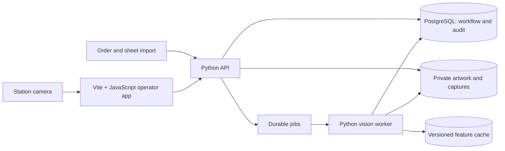

# What Did We Just Print, Man? — final solution plan

Prepared 20 October 2026. Status: proposed delivery plan; decisions below are open unless explicitly described as agreed. This document does not authorize infrastructure spending, production integration or deployment.

Implementation was authorized in the subsequent chat. See [implementation status](IMPLEMENTATION_STATUS.md) and [runbook](RUNBOOK.md) for delivered local behavior, verification and remaining physical/production gates. The baseline description below records the state when this plan was prepared.

## 1. Outcome and evidence

Restore the identity of cut printed products during finishing and packing: capture a product, search current production, show ranked evidence and destinations, and let an operator confirm the allocation. Maintain accurate remaining quantities as work is packed.

Reviewed: the conversation **Assess print-order vision idea**, its local transcript in `chats/assess-print-order-vision-idea.md`, **Move Project Chats**, the asset handoff, this chat's Vite setup, `docs/CONCEPT.md`, and the current source. The transcript contains the original problem, the user's sheet-driven production lifecycle and caching requirements, and the selected visual direction.

Confirmed requirements from the conversations:

- Use original artwork as the reference; capture individual products after cutting removes sheet markers.
- Register sheet composition at the point work enters production. Keep references active through logistics until packing is complete.
- Prepare meaningful visual features once and reuse cached results as the production pool evolves.
- Return multiple ranked candidates, previews and explicit matched-point counts/ratios.
- Treat visually identical artwork belonging to different orders as ambiguous.
- Preserve the dark print-floor UI, orange controls, registration marks and CMYK accents.
- Build the web frontend with Vite and plain JavaScript.

Current implementation, verified by source inspection: order intake, artwork decoding and preview, variant quantities/destinations, text search, browser-local IndexedDB storage and JSON export; Vite development/build setup. There is no shared backend, sheet registration, production lifecycle, camera capture, recognition, authentication or packing ledger yet. The old handoff phrase “search by a scanned reference” is aspirational: current search is text only. The 24-slot empty grid is decoration, not an imposition model. Build and HTTP checks passed in the preceding setup; full Vite browser regression checks remain outstanding.

## 2. Final operator workflow

1. **Intake:** enter/import an order, its variants, immutable artwork versions, trim dimensions, quantities and destinations. Validate missing or duplicate identifiers.
2. **Sheet preparation:** register sheet size and placements, including rotation, front/back, artwork version, allocation and units contributed per impression. Start with manual entry and a documented JSON import; integrate the actual upstream system after obtaining samples.
3. **Reference preparation:** decode, normalize and extract features asynchronously. Show pending, ready and failed states. Invalid artwork cannot silently enter matching.
4. **Production release:** validate the composition and released quantities, then activate allocations. Show readiness separately from lifecycle: released work with failed preparation remains visible as unavailable for matching.
5. **Scan:** select a station, capture or upload a photograph, correct the product boundary, assess quality, and search compatible active references. Request recapture when evidence is inadequate.
6. **Review:** show the best candidates, distinguishing details, geometric evidence, active allocations and remaining quantities. Operator confirms or rejects; unknown and ambiguous results are normal outcomes.
7. **Pack:** after a separate quantity confirmation, record a packing event against a specific allocation. A successful scan alone never increments packed quantity.
8. **Complete/reopen:** fully packed allocations leave active matching. Other allocations sharing the artwork stay active. Reprints create traceable new allocations; packing corrections append reversal events rather than deleting history.

Views: Orders & Artwork; Production Sheets; Active Production; Scan Station; Candidate Review; Packing; History; Administration. Preserve the existing design language, with readable error states, keyboard access, tablet layouts and clear station/network status.

## 3. Proposed architecture

Recommendation: Vite/plain-JavaScript frontend, Python API and computer-vision worker, PostgreSQL, and private file/object storage. Python is proposed for the backend because the recognition experiments can use the same implementation as the service. This extends the user's JavaScript frontend choice; backend language is decision D02.



Begin with one API service and a separate worker process, using a database-backed durable job table. Avoid introducing a broker or distributed index before measured load requires it. Use leases, retries and idempotent writes for jobs. Serve the app and API under one origin in deployment; use a Vite proxy during development. Poll initial scan/job status; add streaming only if needed.

The server owns shared production state. IndexedDB remains a draft/recovery aid, not the authority for packing. During connection loss, retain a draft and show disconnected status; do not claim that packing was committed. Artwork and images live outside transactional rows, with checksums and authorization on reads.

Browser camera access uses `getUserMedia`; plan HTTPS for deployed stations, explicit permission/error handling, device selection and stream cleanup. A calibrated station provides physical-size context: image pixel dimensions alone cannot establish millimetres. Fixed camera and lighting first; adaptive zoom and larger station classes follow evaluation.

Suggested source layout as implementation progresses:

```text
src/                 app shell, views, components, API client, state and styles
server/              API, domain rules, database migrations and importers
vision/              preprocessing, feature extraction, matching and evaluation
tests/               workflow, API, recognition fixtures and browser checks
docs/                contracts, decisions, station guide and runbooks
```

## 4. Domain model and consistency rules

| Entity | Responsibility |
|---|---|
| Order / OrderVariant | Customer reference, required quantity, destination, artwork links |
| ArtworkVersion | Immutable original bytes/hash, side, trim metadata, normalized derivatives |
| ProductionSheet / Placement | Composition revision, coordinates in mm, rotation, side and allocation links |
| ProductionAllocation | A released production quantity for a variant/artwork version; current remaining work |
| PackingEvent | Quantity, allocation, operator, timestamp, idempotency key; corrections reference prior events |
| FeatureCache | Artwork checksum + normalization/algorithm version + parameters; ready/error state |
| StationProfile | Camera, calibrated geometry, product-size range and capture settings |
| Scan / CandidateMatch | Capture, quality, algorithm version, pool revision and ranked evidence |
| ReviewDecision / AuditEvent | Operator decision, reason and traceable workflow changes |

Enforce these invariants on the server:

- Distinct order/variant IDs remain separate even when artwork is shared. Deduplicate feature preparation, not business identity.
- Sheet placement count × impressions informs expected units; release records actual authorized quantities. Repeated placements must not accidentally multiply quantities twice.
- Packing updates run transactionally, reject overpacking and duplicate requests, and handle simultaneous operators safely.
- Normal completion is based on remaining allocation quantities, not elapsed time or closing a sheet screen. Cancellations require a recorded reason and reconciliation of remaining work.
- A scan records the searched pool revision. Revalidate allocation status and remaining quantity at packing commit; stale scans cannot pack already completed work.
- Pending/failed feature jobs are visible. Activation or retirement updates the searchable pool without requiring descriptor recomputation.
- Changing artwork creates a new version. Configuration changes invalidate compatible cache entries deliberately, with rebuilding progress visible.
- Archive completed references for history; retention/deletion rules must account for customer data and shared artwork.

Initial API groups: orders/variants, artwork upload/preparation, sheets/composition/release, active allocations, scans/results, review decisions, packing events/reversals and history. Define JSON schemas, pagination, errors and idempotency before connecting each view. Preserve existing UUIDs during import.

## 5. Recognition and evidence

Implement an evaluated baseline rather than selecting an algorithm from the UI design:

1. Validate and normalize reference images; retain originals and processing versions.
2. Find useful regions and extract candidate binary descriptors; cache per artwork/configuration. Evaluate ORB/Hamming as one baseline, not an assumed final answer.
3. Capture a product, check blur/exposure/glare, locate corners and rectify perspective; permit manual corner correction in the pilot.
4. Filter by active production, station compatibility, calibrated size tolerance and known batch context. Show any operator-selected narrowing and avoid silently excluding plausible matches.
5. Retrieve candidate artwork, geometrically verify tentative feature matches, and inspect distinguishing regions. Evaluate OCR/region comparison if whole-design features cannot separate names.
6. Expand artwork matches to all eligible order allocations and return top-k results. Evaluate top-5 as an initial setting.

For each candidate return rank, artwork/variant/allocation IDs, preview, tentative matches, geometric inliers, `inlierRatio = inliers / tentativeMatches` (undefined when the denominator is zero), region evidence and decision reasons. A ratio is evidence, not a calibrated probability of correctness. Show an overlay or crop explaining the distinguishing details.

Results: suggested match, ambiguous, insufficient quality/evidence, unknown, or service unavailable. Thresholds and top-candidate margin are tuned on validation data and frozen for the held-out test. A high ratio alone does not imply sufficient evidence: a tiny match set can be misleading. Require operator review initially. Identical visible artwork cannot reveal different destinations; resolve with production/tray context or keep it ambiguous. Scanning a top card does not validate a whole stack or count its contents.

## 6. Delivery phases and exit criteria

Phases are dependency-ordered; estimates are engineering effort ranges for one developer, not calendar commitments. They exclude hardware procurement, access delays and upstream integration changes. Recognition results may require redesign.

| Phase | Work and evidence required to finish | Depends on | Indicative effort |
|---|---|---|---|
| P0 — baseline | Modularize current JS, preserve UI, add meaningful browser checks for upload/save/reload/search/export and invalid images. Add safe catalog import with preview and duplicate handling. | Existing app | 2–3 days |
| P1 — shared data | API, database migrations, private artwork storage, operator access and validated catalog migration. Verify two browsers share records and backup restore works. | D02, P0 | 4–7 days |
| P2 — production lifecycle | Sheet editor/import, allocation release, active queue, packing ledger and audit. Verify partial packing, shared artwork, concurrent packing, cancellation, reprint and stale results. | D03, P1 | 5–8 days |
| P3 — camera and baseline | One station; capture/upload, quality gate, feature preparation/cache, ranked results and evidence. Use actual printed samples, including unknown/identical/near-identical designs. | D04, D05, P1; P2 active pool for integration | 5–10 days |
| P4 — evaluated pilot | Full release→scan→review→pack path; frozen held-out evaluation, operator trials, measured latency and failure report. Tune distinguishing-region/OCR work only against validation split. | D06, P2, P3 | 5–10 days |
| P5 — production readiness | Approved deployment, authorization, monitoring, restore drill, load/outage testing, station instructions and rollback. Owner accepts operating costs and pilot results. | D07, D08, P4 | 4–7 days |

Total indicative effort: 25–45 engineering days before substantial ERP integration, multi-site operation or expanded camera classes. A competition demonstration would be a deliberately smaller delivery, with its unimplemented production features clearly identified.

## 7. Evaluation and release gates

Create a labelled corpus with at least the originally discussed 50 near-identical name variants, distinct layouts, identical artwork assigned to different orders, unknown designs, front/back differences, rotation/skew, glare, blur and trim variation. Capture physical prints in separate sessions; reference images are not test photographs. Keep tuning and held-out sessions separate, with duplicate/leakage checks and recorded ground truth.

Report wrong suggested/accepted assignments, top-1/top-5 retrieval, ambiguity and review rates, unknown rejection, recapture rate, operator-confirmed accuracy, p50/p95 latency, active-pool size and test conditions. Distinguish algorithm suggestions from operator outcomes. A report with zero observed errors includes the sample count and uncertainty; it does not prove zero future errors.

D06 sets numerical targets before pilot testing. Suggested initial gates: every deliberately identical-artwork case stays ambiguous without additional context; no invalid/double packing under concurrency tests; every accepted packing action has an audit record; representative held-out results and operator review meet the agreed error budget. Do not promise a particular accuracy or throughput before measurement.

Exercise recovery: worker restart and retries, partial preparation failure, camera unplugged/permission denied, network interruption, API failure, stale candidate pool, browser reload, interrupted imports, full storage and database/object-store restore consistency. The system must expose unavailable service rather than fabricate a match.

## 8. Decisions and owner inputs

Recommendations here are defaults for planning, not previously agreed requirements. Engineering can build local fixtures while owner-dependent work is pending.

| ID | Decision / missing input | Proposed default | Owner and needed by |
|---|---|---|---|
| D01 | First delivery: operational pilot or competition demo? | Operational pilot; keep competition checklist separate | User, before committing scope/dates |
| D02 | Backend and deployment topology | Python API/vision; PostgreSQL; one site first; local development | User approves stack; engineering implements, P1 |
| D03 | Source of orders and sheet compositions | Manual + versioned JSON; obtain representative real composition exports and quantity rules | User supplies examples; engineering maps fields, P2 |
| D04 | First camera station and product size | Selected 20 October 2026: phone camera and business cards; controlled lighting | User provides phone and printed samples; engineering validates geometry and trusted HTTPS access, P3 |
| D05 | Authorized evaluation materials | Synthetic name variants plus authorized physical captures; no unapproved customer artwork | User provides rights/samples; engineering builds corpus, P3 |
| D06 | Acceptable error/review rate and scan latency at stated scale | Human confirmation for every pilot packing action; set numeric limits after initial baseline measurements and before held-out test | User/operations with engineering, P4 |
| D07 | Hosting, budget and cloud data permissions | Local pilot first; cloud/edge split chosen using measured latency and privacy needs | User/account owner, before cloud spending or upload |
| D08 | Operators, retention, integration and rollout | Single organization; operator/supervisor/admin roles; approved retention and recovery objectives | User/operations, P1 access model and P5 release |

## 9. Costs and optional scope

Mandatory for local development: engineering time and existing workstation/storage; no planned paid SaaS dependency. Physical validation requires camera, lighting, mount, prints and operator time; reuse existing equipment where adequate. Shared production requires an approved server/storage location, backups, secure camera access and an operations owner; the cost may be existing capacity or new spend and must be estimated against actual scale.

Optional, separately budgeted: cloud hosting/storage/transfer, managed database, OCR services, GPU, adaptive zoom, multiple station sizes, ERP integration and agentic recapture. Do not purchase or provision until D07 has an estimate and approval. Begin with CPU measurements; a GPU is not assumed necessary.

## 10. Competition track and current documentation

The original conversation assessed an OpenCV/AWS competition. That history does not make the current app competition-ready. If D01 includes submission, create a separate current requirements/evidence matrix covering exact OpenCV version/build, substantive AWS execution, eligibility, rights, reproducibility, report/demo/video and deadline/timezone. OpenCV 5 compatibility is a build/evaluation task, not established by consulting older OpenCV examples. Do not reuse the old deadline claim as a verified current deadline.

Primary references reviewed on 20 October 2026:

- [FastAPI documentation](https://fastapi.tiangolo.com/): Python API and documented contracts; technology recommendation above is our design judgment.
- [OpenCV feature matching and homography tutorial](https://docs.opencv.org/4.x/d1/de0/tutorial_py_feature_homography.html): geometric-verification concepts; this is a 4.x tutorial and does not establish OpenCV 5 runtime compatibility or validate our algorithm.
- [MDN getUserMedia](https://developer.mozilla.org/en-US/docs/Web/API/MediaDevices/getUserMedia): browser camera permissions and secure-context requirements.
- [Competition rules](https://opencv26.devpost.com/rules): authoritative entry point for a separate submission audit, not a production acceptance specification.

## 11. First implementation milestone

Start P0, then deliver P1/P2 as the first usable shared workflow: import an existing catalog, register a sheet, release allocations, view active work, pack part of one variant, reload from another browser, finish packing, and verify the matching pool retires only the completed allocation. Use labelled manual review until recognition is evaluated. This establishes the production truth that all later matching depends on.
